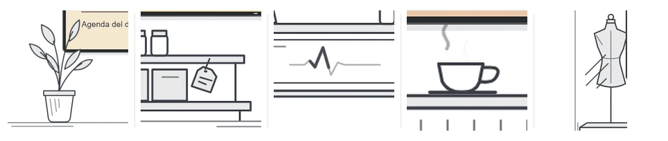
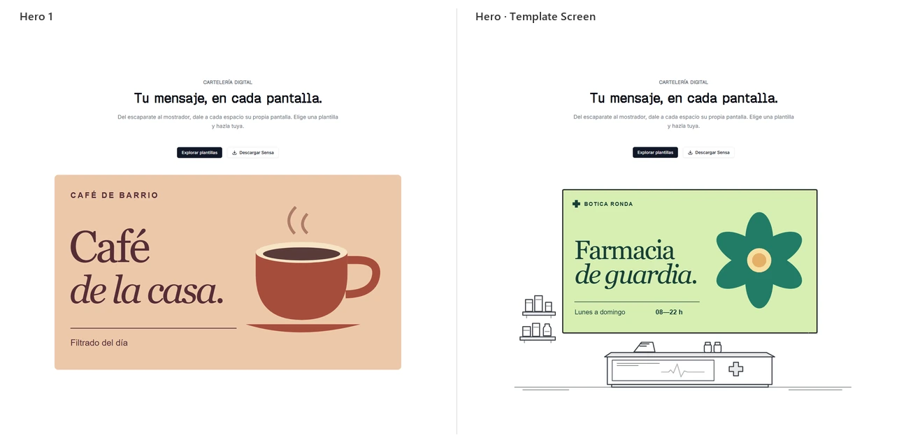
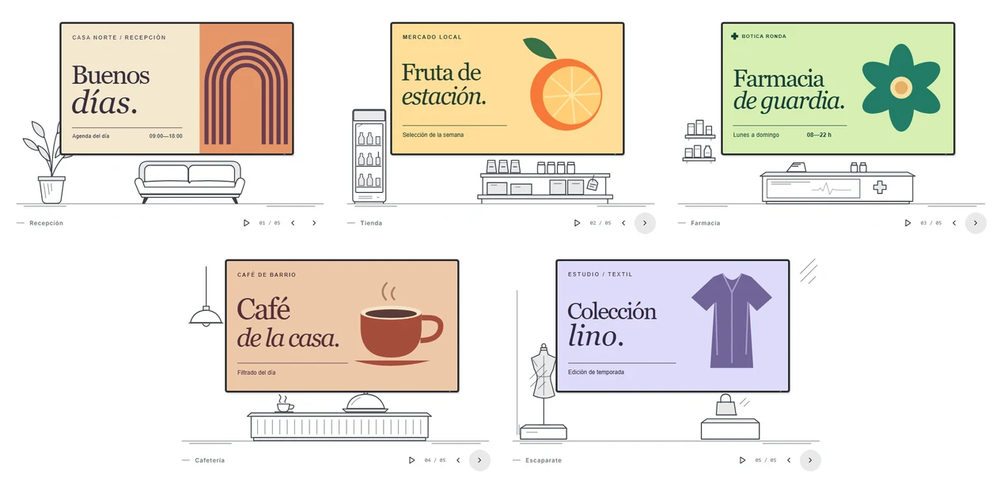

# Hero · Template Screen

En Studio, abre una página y añade el bloque **Hero · Template Screen**. Puedes preparar el texto, hasta dos botones y las plantillas de cada idioma en su propia página. Los botones admiten enlaces y descargas de SensaVision Desktop.

**Hero 1** y **Hero · Template Screen** comparten el campo **Layout**. Elige **Text above** para centrar el texto y los botones arriba. Debajo, la imagen de Hero 1 o la escena animada ocupa todo el ancho del contenido de la página. **Side by side** sitúa el texto a la izquierda en escritorio y arriba en móvil. Es la composición predeterminada, también para los bloques creados antes de añadir el campo.

1. **Default scene** define el ambiente que heredan las plantillas. El bloque nuevo ya trae *Office or reception*.
2. En **Templates**, añade una imagen y describe su mensaje en **Alt text**. Para publicar el bloque hace falta al menos una plantilla con imagen y texto alternativo.
3. Para una página de farmacias, elige *Pharmacy* una vez en el bloque. Cada plantilla mostrará **Use default (Pharmacy)**. Para el home, cambia **Scene** solo en las plantillas que necesiten otro ambiente. Puedes volver a **Use default** en cualquier momento.
4. Arrastra las filas para cambiar el orden. Reemplazar la imagen de una fila conserva su posición. En vista previa, reordenar conserva la plantilla que estás viendo. Si la eliminas, la pantalla pasa a la primera disponible.

La pantalla horizontal muestra la plantilla completa. Mientras la plantilla se ve, en recepción se mecen las hojas, en la tienda oscila una etiqueta y en la farmacia un pulso recorre el mostrador. En la cafetería sube vapor de la taza y en el escaparate se desplaza un reflejo sobre el cristal. Estos detalles utilizan cinco animaciones Lottie locales que adoptan los colores del tema.

<picture>
  <source media="(prefers-reduced-motion: reduce)" srcset="hero-screen/ambientes.webp">
  
</picture>

Con varias plantillas, la imagen cambia cada cinco segundos con un fundido de 450 ms. Dos plantillas del mismo negocio comparten la animación en curso. Con una sola plantilla, la imagen permanece fija y el ambiente se anima en bucle mientras está a la vista. Debajo aparece un botón para pausar o reanudar el movimiento.

En la web, los controles usan el idioma de la página y admiten teclado y tacto. Pasar el puntero por la escena mantiene la plantilla visible mientras se mueve el ambiente. **Pausar** detiene tanto el dibujo como el carrusel y **Reproducir** los reanuda. Al entrar con teclado, la reproducción espera a que se pulse **Reproducir**. Con movimiento reducido se muestra la ilustración fija, el avance empieza pausado y los cambios son instantáneos. Si una imagen falla, se conserva la última disponible. Si faltan todas, aparece **Pantalla en reposo**.

## Verificación local

Con Node en el rango del proyecto y Chromium de Playwright instalado:

```sh
npm run check
npm run test:hero-screen
```

La prueba de navegador utiliza plantillas sintéticas, el componente real, los estilos del sitio y la consulta de páginas. El formulario de Studio usa referencias de imágenes locales y guarda el documento en el navegador. La vista previa recibe las ediciones en otra pestaña. El cargador de imágenes de prueba sustituye el servicio remoto de optimización.

Para recorrer la demostración a mano, ejecuta `npx vite --config tests/browser/hero-screen/vite.config.mts --port 4184` y abre el [recorrido por los cinco ambientes](http://127.0.0.1:4184/?scenario=tour) o la [farmacia con tres plantillas](http://127.0.0.1:4184/). Puedes añadir `theme=dark` y `locale=en` a la URL.

Para ver el texto arriba, abre las demos de [Hero 1](http://127.0.0.1:4184/?hero=1&layout=vertical) y del [hero con pantalla](http://127.0.0.1:4184/?layout=vertical&scenario=tour).



Las capturas reproducibles de los ocho cruces de idioma, tema y tamaño y de los cinco ambientes quedan en `output/playwright/hero-screen/`.

En los ocho casos, el marco y los controles conservaron sus coordenadas. Playwright comprueba que cada dibujo cambie de fotograma mientras la plantilla sigue fija, que responda a la pausa y que conserve el color del tema. Si falla un Lottie, queda visible el dibujo estático y se puede avanzar al siguiente ambiente. Las pruebas también cubren imágenes verticales o fallidas y la persistencia del orden al reabrir el formulario de Studio.



| Idioma y tema | Escritorio, 1440 px | Móvil, 375 px |
| --- | --- | --- |
| Español claro | [Escritorio](hero-screen/desktop-light-es.webp) | [Móvil](hero-screen/mobile-light-es.webp) |
| Español oscuro | [Escritorio](hero-screen/desktop-dark-es.webp) | [Móvil](hero-screen/mobile-dark-es.webp) |
| Inglés claro | [Escritorio](hero-screen/desktop-light-en.webp) | [Móvil](hero-screen/mobile-light-en.webp) |
| Inglés oscuro | [Escritorio](hero-screen/desktop-dark-en.webp) | [Móvil](hero-screen/mobile-dark-en.webp) |
